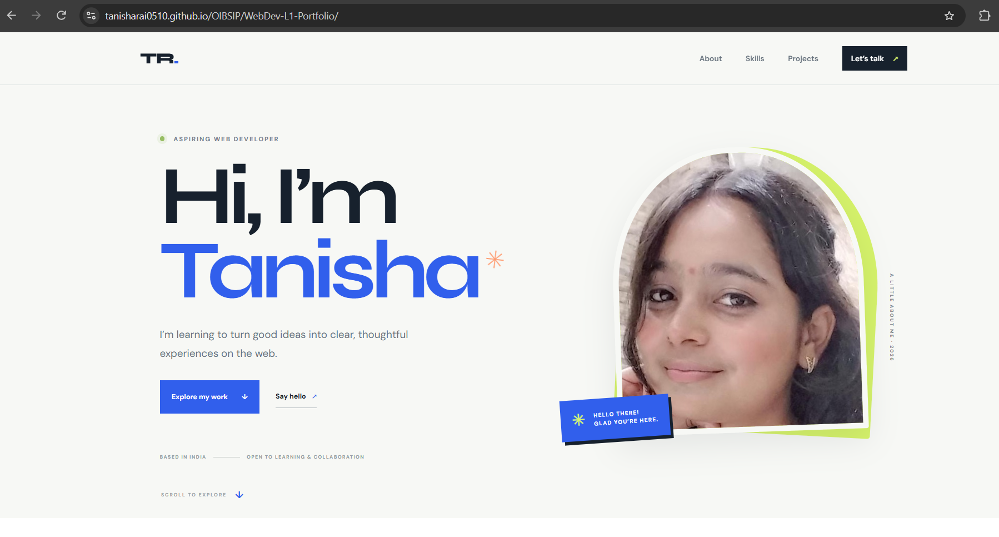
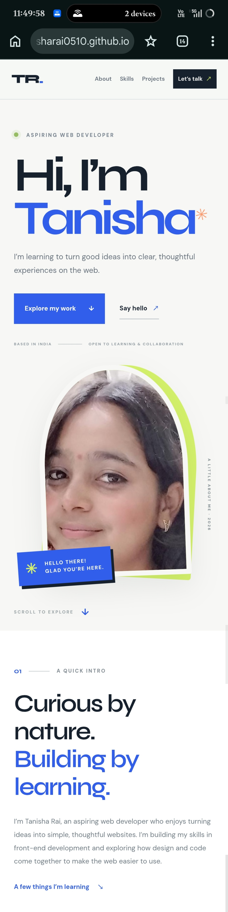

# Task 2 – Personal Portfolio

**Track:** Web Development & Designing · **Level 1 · Task 2**

A responsive personal portfolio website for **Tanisha Rai**, an aspiring web developer. It works as a digital résumé and showcases my introduction, skills, projects and contact details.

## Screenshots

| Desktop | Mobile |
|---------|--------|
|  |  |

## Sections

1. **Hero:** my name, role (aspiring web developer) and a profile photo
2. **About Me:** a short introduction to my background and interests
3. **Skills:** a grid of the tools I use: HTML5, CSS3, JavaScript, Responsive Design, Git & GitHub
4. **Projects:** project cards for my Landing Page and Temperature Converter, each with preview and GitHub links
5. **Contact:** email link and a closing call to action

## Features

- Sticky navigation with smooth scrolling between sections
- Consistent branding: one colour scheme and a two-font pairing (Syne for headings, DM Sans for body text)
- Fully responsive layout for desktop, tablet and mobile
- Project cards that link to my other Level 1 projects
- `prefers-reduced-motion` support for accessibility

## Tech Stack

- HTML5
- CSS3 (Flexbox, Grid, animations, media queries)
- Google Fonts

## Project Structure

```
WebDev-L1-Portfolio/
├── index.html
├── styles.css
├── assets/
│   └── tanisha-headshot-v2.jpeg
├── screenshots/
└── README.md
```

## How to Run

1. Download or clone the repository.
2. Open `WebDev-L1-Portfolio/index.html` in any modern browser.

The "Preview" links on the project cards open the sibling project folders, so keep the repository folder structure unchanged.

## What I Learned

- Designing and structuring a multi-section personal website
- Smooth-scroll navigation and sticky headers
- Responsive design across different screen sizes
- Presenting projects clearly to employers and recruiters

## Contact

**Tanisha Rai** · raitanisha510@gmail.com
Oasis Infobyte Internship · #oasisinfobyte
